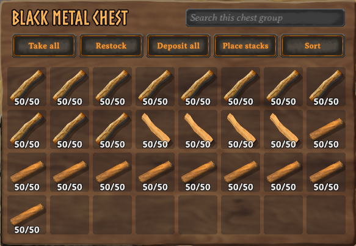
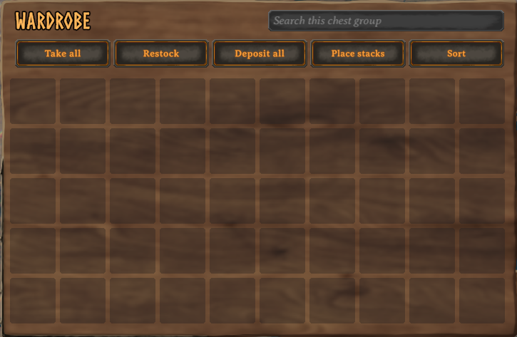
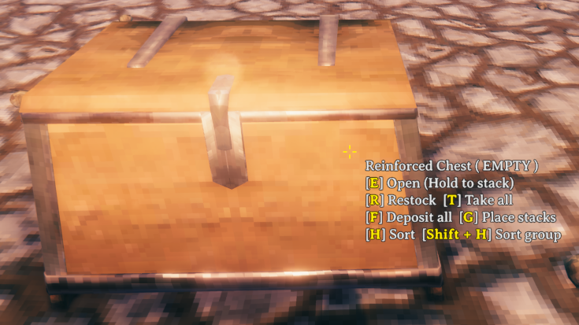
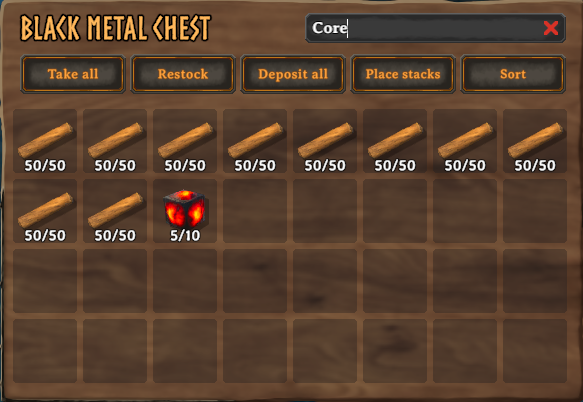
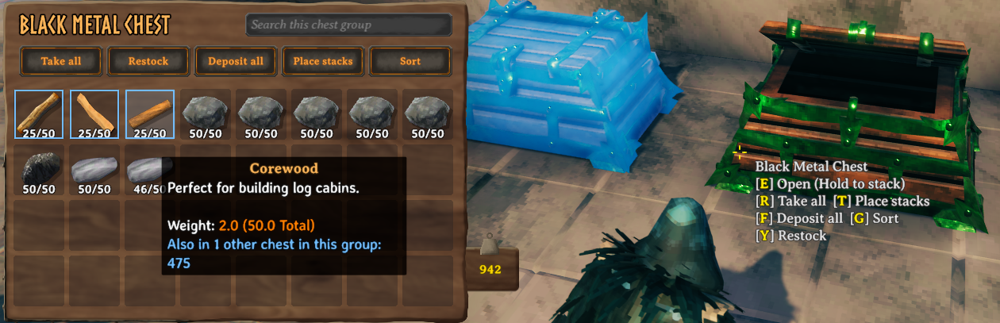
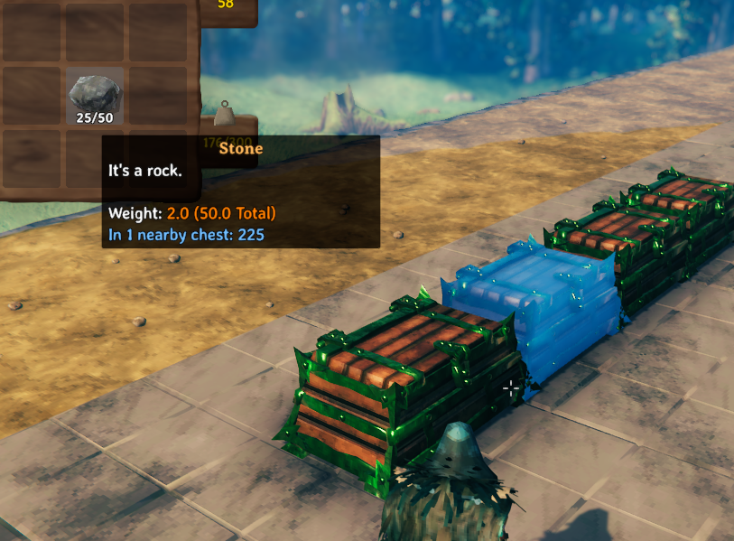
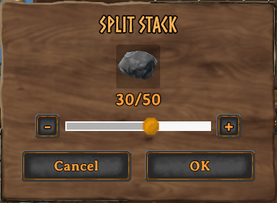

# BetterChests

Chests standing together form a group you can use as one: search it, deposit into it and restock from it with a redesigned chest panel and keys, plus auto deposit and smarter sorting.

## Chest Groups

Chests standing close together form a **group**, such as a row, a wall or a stack of chests.
A chest joins a group when it is within a metre of any chest already in it (the `Cluster Gap` setting), so a group can run the length of a storage room.

Only chests you could open yourself are used: not other players' private chests or chests inside someone else's ward.
A chest another player has open is skipped until they close it.

Everything in the mod is built on groups:

- **Search** the whole group from any chest in it, and take, use, deposit or gather items across it.
- **Restock** your partial stacks from the whole group.
- **Auto deposit** items you drop into the group, next to the same items.
- **Duplicates** shows which items are spread over several chests in the group.

## The Chest Panel

The open chest's name is at the top left, with the search bar beside it, and the five buttons are in one row underneath.
The panel grows taller to show every row of big chests without scrolling, as far as the bottom of the screen, and the wardrobe is shown as 10 columns by 5 rows instead of 5 by 10.

### Buttons and Keys

Every button has a key, shown in the key hints at the bottom of the screen and in a chest's hover text.
The keys also work while just looking at a chest, without opening it, and a message says what moved.
While you search, the buttons work on the whole group instead of the open chest.

| Button       | Key | On the open chest                                                           | While searching the group                                                                                   |
| ------------ | --- | --------------------------------------------------------------------------- | ----------------------------------------------------------------------------------------------------------- |
| Take all     | `R` | Moves everything in the chest into your inventory.                          | Takes every stack the search shows.                                                                         |
| Restock      | `Y` | Tops up every partial stack you carry from the whole group.                 | The same.                                                                                                   |
| Deposit all  | `F` | Moves everything you carry into the chest, except kept items (see below).   | Puts each item in the chests that already hold it, topping up their stacks first, and the rest in this one. |
| Place stacks | `T` | Tops up stacks already in the chest with what you carry, except kept items. | Tops up stacks anywhere in the group with the items you carry that match the search.                        |
| Sort         | `G` | Sorts the chest.                                                            | Gathers each item the search shows into the chest holding the most of it, then sorts that chest.            |

All the keys can be changed in the config file.

### Search

Type in the search bar to search the open chest and every chest grouped with it.
While you type, the chest's grid shows every matching item from the whole group, as if it were one chest, in sort order:

- Click an item to take that stack into your inventory, straight from the chest it is in.
- Shift + click it to split the stack, and take only part of it.
- Right-click it to eat or drink it from that chest, or to take it and equip it.
- Drag an item from your inventory onto the results, or Ctrl + click it in your inventory, to put it in the chests that already hold that item (the same way as **Deposit all**).
- Click the red cross at the end of the search bar to clear it.

### Keeping Items

**Deposit all** and **Place stacks** never move your hotbar (the top row of your inventory) or anything you have equipped, so you can empty your bags after an adventure without losing your gear.
To keep other items too, such as your food, hold `Alt` and right-click them in your inventory to mark them. Marked items get a frame; do the same again to unmark them.

### Duplicates

Items in the open chest that another chest in its group also holds get a blue frame, so you can see what could be gathered into one chest (searching for it and pressing **Sort** does that).

Hovering over an item in the chest makes the other chests in the group that hold it glow, and its tooltip says how many of them there are and how much they hold.
Hovering over an item in your inventory does the same for every chest group within auto deposit range of you, so you know where to take it.

### Split Stack

The split stack dialog (Shift + click a stack) gets **-** and **+** buttons either side of the slider to change the amount by one, and so does the mouse wheel.
This works in your inventory as well as in chests.

## Auto Deposit

Drop an item near any chest in a group, and it is stored in the group: in a chest that already holds that item if there is one, otherwise in any chest with room.

## Sorting

Sorting merges partial stacks, then groups related items together, in this order: wood, stone and minerals, ores, metal bars, nails and other metal parts, hides, other creature parts, valuables, other materials, upgrade kits, moulds and casts, seeds, raw meat and fish, crops, cooked food, meads, other consumables, then ammo, weapons, shields, tools, armour, utility items and trophies.
Within each group, items are ordered by tier, from the earliest biome to the latest. Also:

- Crops (anything picked from a plant, edible or not) are ordered by tier.
- Cooked food is ordered by the stat it raises most (health, balanced health and stamina, stamina, then eitr), lowest first.
- Armour is grouped by set, then helmet, chest, legs, gloves and cape.
- Weapons are grouped by class (swords, axes, clubs, spears, polearms, knives, fists, bows, crossbows, staffs), one-handed before two-handed.
- Moulds and casts are ordered like the gear they make: armour sets first, then weapons, then shields.
- Upgrade kits: armour kits by tier, then weapon kits by tier.
- Meads are grouped by what they do (health, stamina, eitr, each resistance, then the rest), then by tier, with their bases first.

Items from other mods are sorted the same way, by what the game says they are and where they come from.

## Configuration

Settings are in the BepInEx config file `javidahmed64592.betterchests.cfg`.
Settings marked "(Synced with server)" use the server's values when the server has the mod installed.

## Compatibility

- Other chest mods that add sorting, quick stacking or auto storing (such as Quick Stack - Store - Sort - Trash - Restock) overlap with this mod. Their keys may clash with `R`, `T`, `F`, `G` and `Y` (all can be changed in the config file), and their buttons may overlap on the chest panel.
- This mod has not been tested with a gamepad, only with keyboard and mouse.

## Uninstalling

The mod can be removed at any time.
Items marked to keep (Alt + right-click) keep a small marker in their data, which does nothing without the mod.

## License

This project is licensed under the MIT License - see the [LICENSE](https://github.com/javidahmed64592/Valheim-BetterChests/blob/main/LICENSE) file for details.
