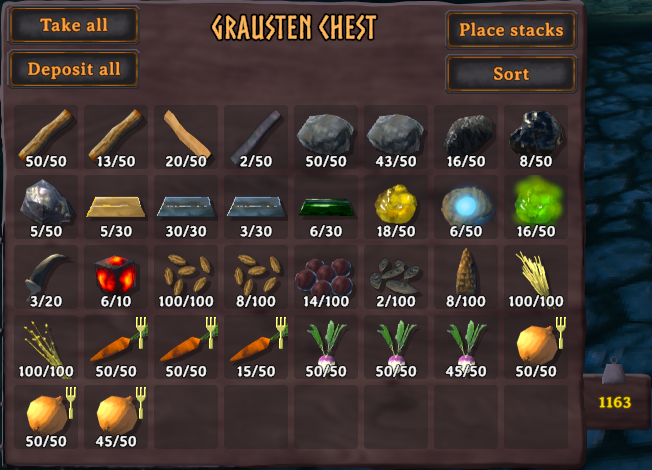

# BetterChests

Enhances chests with additional features like sorting and auto-depositing!

| Key | Action                                                                         |
| --- | ------------------------------------------------------------------------------ |
| `H` | Take all: move everything in the open chest into your inventory.               |
| `F` | Place stacks: move items onto matching stacks in the open chest.               |
| `G` | Sort the open chest.                                                           |
| `R` | Take one fewer item when splitting a stack (Shift+click). Hold to keep going.  |
| `T` | Take one more item when splitting a stack (Shift+click). Hold to keep going.   |

The keys are listed in the inventory's key hints.
All of them can be changed, see [Configuration](#configuration).

## Auto Deposit

Dropping an item near chests stores it in them instead of on the ground.
Chests that already hold the item are filled first, nearest first, then any other chest with room.

Only chests you could open yourself are used: not private chests of other players, chests inside someone else's ward, or chests another player has open.

## Sort

The open chest gets a **Sort** button beside it.
Sorting merges partial stacks, then groups items by type (materials, food, fish, ammo, weapons, armour, utility items, trophies and so on).

## Split Stack

The split stack dialog gets **-** and **+** buttons either side of the slider to change the amount by one.
The number keys, arrow keys and Enter still work as before.

## Configuration

Settings are in the BepInEx config file `javidahmed64592.betterchests.cfg`.
You can change the keys, turn auto deposit off, and change how far away chests are used for dropped items (10m by default).

## License

This project is licensed under the MIT License - see the [LICENSE](https://github.com/javidahmed64592/Valheim-BetterChests/blob/main/LICENSE) file for details.
