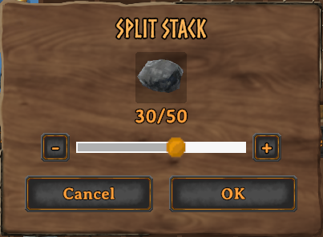

# BetterChests

Enhances chests with additional features like sorting and auto-depositing!

| Configurable Key    | Action                                                                                          |
| ------------------- | ----------------------------------------------------------------------------------------------- |
| `R`                 | Take all: move everything in the open chest into your inventory.                                |
| `T`                 | Place stacks: move items, except marked ones, onto matching stacks in the open chest.           |
| `F`                 | Deposit all: move everything except your hotbar, equipped and marked items into the open chest. |
| `G`                 | Sort the open chest.                                                                            |
| `Alt` + Right-click | Mark or unmark an item in your inventory to keep it when depositing all or placing stacks.      |
| Mouse wheel         | Change the amount by one when splitting a stack (Shift+click).                                  |

## Auto Deposit

Chests standing close together form a group, such as a row or a stack of chests.
Dropping an item near any chest in a group stores it in them, prioritising chests which already contain that item.

Only chests you could open yourself are used: not private chests of other players, chests inside someone else's ward, or chests another player has open.

## Chest Panel

The chest panels have been improved with additional features and better layout handling.

### Layout

The chest panel grows taller to show every row of big chests without scrolling, as far as the bottom of the screen.
The wardrobe is shown as 10 columns by 5 rows instead of 5 by 10, with the panel widened to fit.

### Deposit All

The open chest gets a **Deposit all** button under **Take all**.
It moves everything in your inventory into the chest, except your hotbar (the top row of your inventory) and anything you have equipped, so you can empty your bags after an adventure without losing your gear.
To keep other items too, such as your food, hold **Alt** and right-click them in your inventory.
Marked items are also kept by **Place stacks**.

### Sort

The open chest gets a **Sort** button under **Place stacks**.
Sorting merges partial stacks, then groups related items together, in this order: wood, stone and minerals, ores, metals, creature parts, valuables, seeds, crops, raw meat and fish, food, meads, then ammo, weapons, shields, tools, armour, utility items and trophies.

### Split Stack

The split stack dialog gets **-** and **+** buttons either side of the slider to change the amount by one, and so does the mouse wheel.
These features are also available when splitting stacks in your inventory.

## Configuration

Settings are in the BepInEx config file `javidahmed64592.betterchests.cfg`.
Settings marked "(Synced with server)" use the server's values when the server has the mod installed.

## Compatibility

- Other chest mods that add sorting, quick stacking or auto storing (such as Quick Stack - Store - Sort - Trash - Restock) overlap with this mod. Their keys may clash with `R`, `T`, `F` and `G` (all can be changed in the config file), and their buttons may overlap on the chest panel.
- This mod has not been tested with a gamepad, only with keyboard and mouse.

## Uninstalling

The mod can be removed at any time.
Items marked to keep (Alt + right-click) keep a small marker in their data, which does nothing without the mod.

## License

This project is licensed under the MIT License - see the [LICENSE](https://github.com/javidahmed64592/Valheim-BetterChests/blob/main/LICENSE) file for details.
